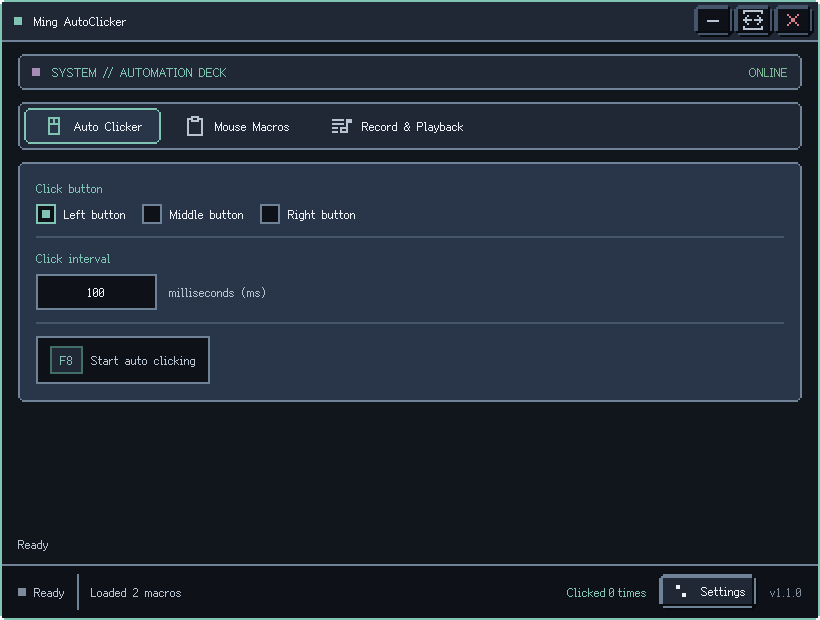
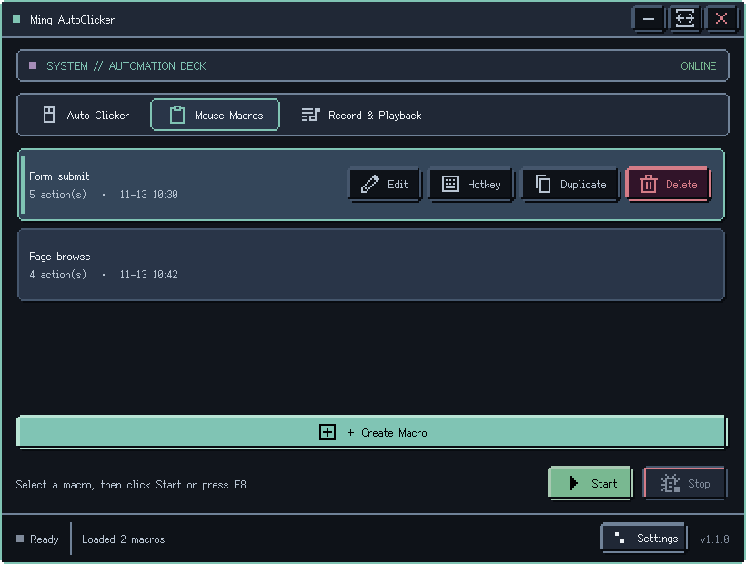
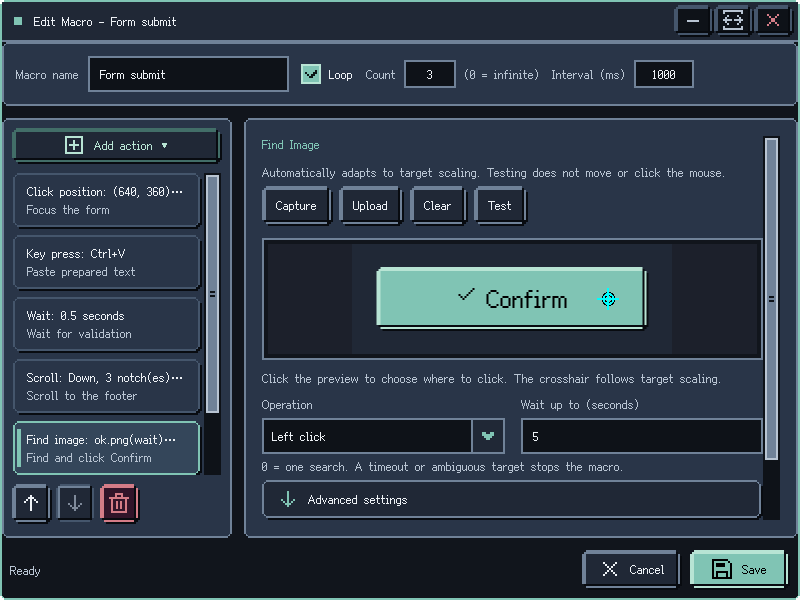
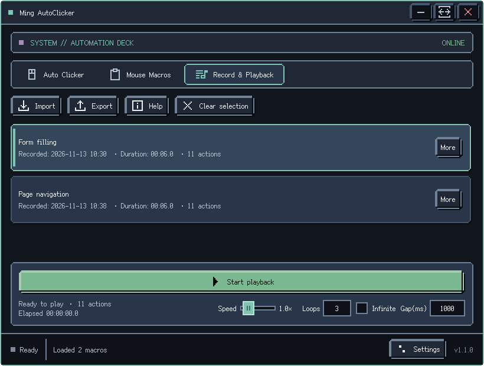
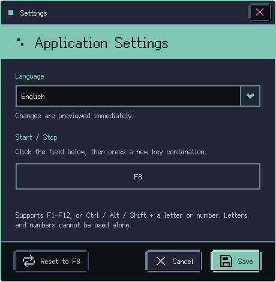

[简体中文](README.md) | [English](README.en.md)

# Ming AutoClicker — Windows Auto Clicker &amp; Macro Recorder

**Windows Auto Clicker, Mouse &amp; Keyboard Macro Recorder, and Image Recognition Automation Tool**

Ming AutoClicker is a WPF and OpenCV desktop automation tool with continuous clicking, mouse and keyboard recording/playback, editable macros, image recognition, coordinate clicks, and per-item global hotkeys.

Current version: **v1.1.0** · [Download the latest release](https://github.com/vigosss/AutoMouseClicker/releases/latest)

---

## Features

### Auto Clicker

- Left, middle, and right mouse buttons
- Configurable interval from 10 ms to 60,000 ms
- Live click counter
- Configurable global start/stop hotkey (`F8` by default)

### Mouse &amp; Keyboard Recorder

- Records mouse movement, clicks, wheel input, and keyboard actions
- Pause recording to resume appending, or stop to save captured actions; stopping playback makes the next run start from the beginning
- Card menus provide hotkey assignment, optimization, renaming, and deletion; JSON import/export is supported
- Fixed two-row footer: controls above; status and elapsed time on the left below, with speed slider and loop settings on the right
- Playback uses one Start/Stop button; recording retains Start, Pause/Resume and Stop to save
- Per-loop completed/total action counts, loop number, and elapsed time; pauses are excluded and selecting another recording resets progress
- Per-recording global hotkeys
- Virtual-desktop coordinate mapping when the display layout changes

### Macro Editor

- Create, edit, duplicate, and delete macros
- Arrange steps with the Move Up and Move Down buttons
- Supports Find Image, Wait, Click, four-direction Scroll, and single-key / keyboard shortcut actions
- Optional notes for each step
- Fixed-count or infinite loops with a configurable interval
- JSON storage with atomic writes to reduce the risk of interrupted writes corrupting data

### Image Recognition

- Template matching powered by Emgu CV (OpenCV)
- Cached templates, grayscale images, and scaled variants, invalidated when template files change
- Automatic 0.5x–2.0x uniform-scale search with local refinement; no scaling checkbox
- Grayscale candidates verified against color and structure; ambiguous or uninformative targets do not click
- Advanced correlation threshold (0.8 by default; this is not a probability)
- The configured threshold is never automatically lowered to accept a match
- Full-screen region capture or local image upload
- Desktop, fixed-region, or visible-window scopes with optional relative client-area selection
- Click anchors selected on the preview, ignored dynamic areas, transparency, and alternate appearances
- New actions wait up to 30 seconds or search once; fresh-frame verification before clicking, with no click after cancellation or timeout
- Multi-monitor, negative-coordinate, and DPI-aware capture
- Cancellable recognition-only tests display candidates and click points on the actual matched frame

### Region Capture

- Full-screen capture overlay
- Drag to select a target region
- Eight handles for adjusting the selection
- Live selection dimensions

### Retro Pixel UI

- Dark retro pixel theme with consistent stepped borders, buttons, lists, and scrollbars
- Bundled open-source CJK pixel font across windows, dialogs, and capture overlays
- Resizable main window and editors, with layouts checked at common display scales
- Live execution status in the bottom status bar
- Simplified Chinese and English, with system-language detection and instant switching in Settings

---

## Interface Overview

### Auto Clicker

Configure the mouse button and interval, then start or stop with the global hotkey.

### Mouse Macros

Create and manage automation macros, with an optional hotkey for each macro.

### Macro Editor

Combine Find Image, Wait, Click, Scroll, and Keyboard actions, and configure each step in its properties panel.

### Recording and Playback

Manage recordings and use the fixed two-row footer to view status, adjust speed, and configure loops.

### Settings

Change the interface language and configure the global start/stop hotkey.

---

## Requirements and Installation

- Windows 11 (Windows 10 is best-effort and is not part of the supported test matrix)
- Self-contained .NET 10 build; installing a separate runtime is not required
- Download the latest ZIP package from [GitHub Releases](https://github.com/vigosss/AutoMouseClicker/releases)
- Extract the complete archive, then run `Ming-AutoClicker.exe`
- Global hotkeys or simulated mouse input may require running the application as administrator in some environments

The application checks GitHub Releases on startup. When a required update is available, it downloads and installs the update from inside the app.

---

## Source Layout

`Views` is organized by feature. Each XAML file stays beside its `.xaml.cs` file, and namespaces match the folders.

| Directory | Contents |
|---|---|
| `Views/AutoClick` | Auto-clicker page |
| `Views/Macros` | Macro list and editor |
| `Views/Recordings` | Recording, playback, optimization and renaming |
| `Views/ImageMatching` | Region/window selection, match results, template editing and preview |
| `Views/Shared` | Common dialogs, coordinate picker and per-item hotkeys |
| `Views/Settings` | Global hotkey and language settings |
| `Views/Updates` | Update window |

Place new views in their feature folder and reusable cross-feature windows in `Shared`. The application entry point and main window remain at the project root; common styles live in `Styles`.

---

## Usage

### Auto Clicker

1. Open the **Auto Clicker** tab.
2. Choose the left, middle, or right mouse button.
3. Set the click interval in milliseconds.
4. Move the pointer to the target position.
5. Press the configured global hotkey (`F8` by default) to start, and press it again to stop.

### Mouse Macros

1. Open the **Mouse Macros** tab.
2. Select **Create Macro**, then choose **Edit**.
3. Click **Add action** above the action list, then choose Find, Wait, Click, Scroll, or Keyboard.
4. Configure each action and reorder steps with Move Up and Move Down.
5. Save the macro.
6. Select it and click **Start**, or press the configured global hotkey.

### Scroll and Keyboard Actions

- **Scroll**: choose up, down, left, or right and a positive number of notches; the default is one notch down. Each notch represents 120 Windows wheel units. The system and target application determine the distance; horizontal scrolling requires support in the target application.
- Scroll at the current pointer position, or select screen coordinates with the coordinate picker. Negative coordinates on multiple monitors are supported. The pointer remains at the specified position after scrolling.
- **Keyboard**: choose a main key and optional Ctrl, Alt, Shift, or Win modifiers. Each step presses and releases the combination once. Letters, digits, F1–F24, arrow / navigation / editing keys, and the numeric keypad are supported; holding keys and inserting text blocks are outside this feature.
- Keys go to the foreground window. Add a preceding Click action to focus the intended control and Wait actions where a delay is needed. Release physically held modifiers and the target key before the keyboard step runs; the macro remains stoppable while waiting for release.
- If a step matches an active global, macro, or recording control hotkey in this app, startup reports the conflicting step. Change the action or control hotkey before running. The macro can still be saved, and physical control hotkeys remain available to stop execution.
- Existing macros remain compatible with this version. Older versions may not load macros containing Scroll or Keyboard actions.

### Find Image Action

| Option | Description |
|---|---|
| Capture / Upload | Capture a screen region or import a local template image |
| Click position | Select on the preview; defaults to the center and follows the matched size |
| Operation | Left-click or right-click after a match |
| Wait time | New actions default to 30 seconds; 0 requests one bounded search |
| Advanced: threshold | Grayscale correlation threshold; color and structure must also pass verification |
| Advanced: scope | Visible desktop, fixed screen region, or selected window and relative client region |
| Advanced: multiple targets | Reject ambiguity by default, or explicitly select the Nth result sorted by Y then X |
| Edit template | Select click position, mark ignored areas, reset to center, or clear ignored areas |
| Alternate appearances | Additional templates for the same step, each with its own anchor and ignored areas |

Legacy macros retain their waiting behavior and fixed-pixel X/Y offsets until a new click anchor is selected. Both legacy `AdaptiveScale` values now use automatic matching. An unavailable explicit scope never falls back to other windows. Window matching requires visible, non-minimized, unobscured content. Uniform scaling is supported; arbitrary rotation, nonuniform stretching, and layout changes are not guaranteed to match.

### Settings and Hotkeys

Open **Settings** in the lower-right corner to choose **Follow system**, **简体中文**, or **English**, and to configure the global start/stop hotkey.

Supported hotkeys are `F1`–`F12`, or `Ctrl` / `Alt` / `Shift` combined with a letter or number. Letters and numbers cannot be used alone to prevent accidental activation while typing.

| Key | Action |
|---|---|
| Configured global hotkey (`F8` by default) | Start or stop the current auto-clicker/macro mode |
| `ESC` | Close or cancel capture, coordinate picker, and match-result overlays |

---

## Data and Compatibility

- Macros are saved as JSON files and remain compatible across language changes.
- Template images are stored in the application screenshot data folder.
- Language and hotkey preferences are stored per Windows user and survive application updates.
- Macro names, step notes, filenames, and release notes are shown exactly as written and are not automatically translated.

---

## Changelog

### v1.1.0

- Added four-direction Scroll, single-key, and keyboard shortcut macro actions, with checks for control-hotkey conflicts before execution.
- Made scaled image search automatic, with color and structure verification, multiple-target handling, window / region scopes, and verification before clicking.
- Added template click anchors, ignored regions, and alternate appearances, with cancellable recognition previews and configurable timeouts.
- Improved playback progress, pause timing, input cleanup on stop, and state transitions, with a fixed two-row recording footer.
- Wait for playback to release keys and mouse buttons before exiting, and preserve potentially referenced templates when a macro file fails to load.
- Unified the retro pixel interface, corrected bundled-font resolution and icon scaling, and improved Chinese and English layouts at common display scales.
- Added automated regression checks and release-attachment validation; release packages include licenses, third-party notices, and source/build information.
