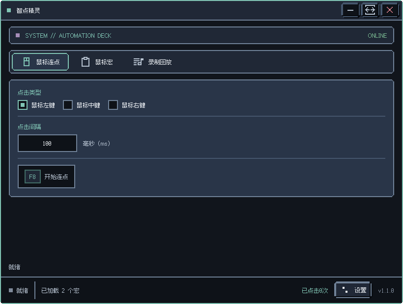
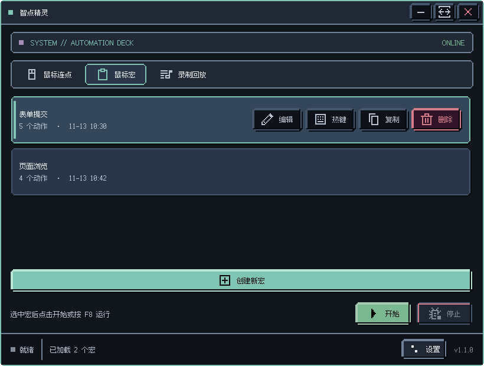
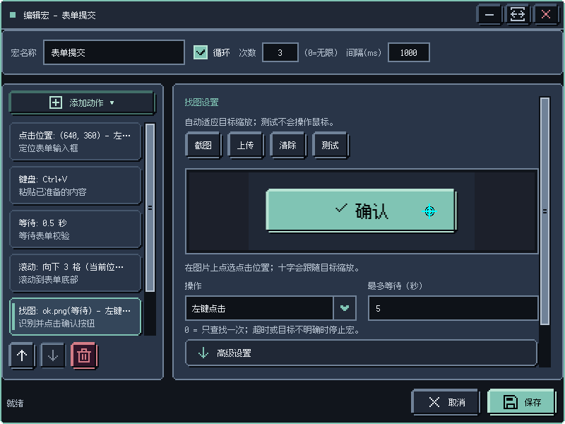
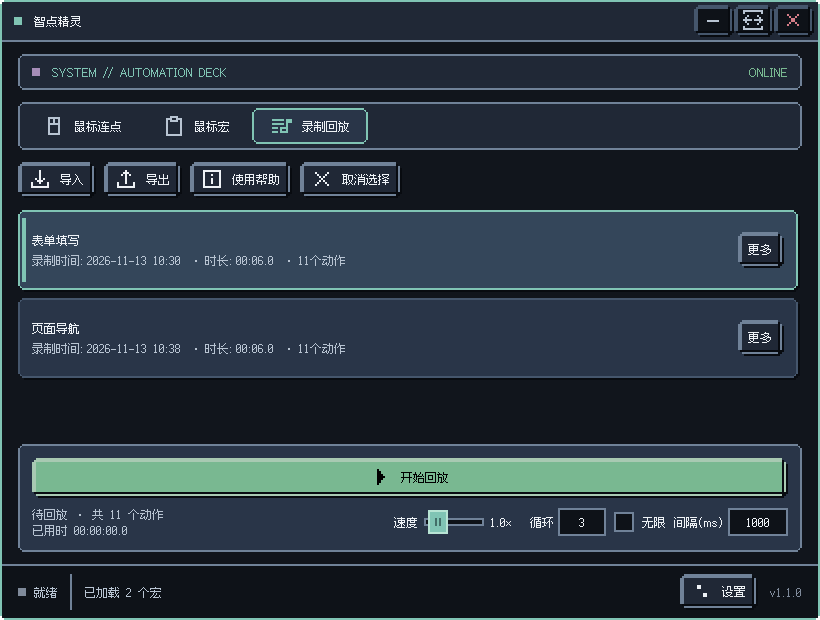
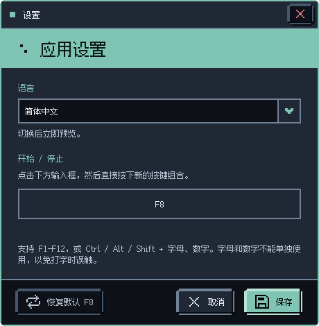

[简体中文](README.md) | [English](README.en.md)

# 智点精灵 Ming AutoClicker

**Windows 自动连点、鼠标键盘录制回放、鼠标宏与图像识别找图点击工具**

一款基于 WPF + OpenCV 的 Windows 桌面自动化工具，支持自动连点、鼠标键盘录制回放、可视化宏编辑、图像识别找图点击与独立全局热键，适用于重复操作自动化和 UI 测试等场景。

当前版本：**v1.1.0** · [下载最新版本](https://github.com/vigosss/AutoMouseClicker/releases/latest)

---

## 功能亮点

### 鼠标连点

- 支持左键、中键、右键点击
- 可自定义点击间隔（10 ms ~ 60000 ms）
- 实时显示点击次数统计
- 可配置全局热键一键启停（默认 `F8`）

### 录制回放

- 录制鼠标移动、点击、滚轮和键盘输入
- 暂停录制可继续追加，停止录制会保存动作；停止回放后再次开始会从头执行
- 卡片“更多”菜单提供热键、优化、重命名和删除，支持 JSON 导入/导出
- 固定两行控制栏：第一行操作；第二行左侧显示状态和已用时，右侧为速度滑条、循环次数、无限循环和间隔
- 回放主按钮切换开始/停止；录制保留开始、暂停/继续和停止保存
- 显示本轮已执行/总动作数、循环轮次及已用时；暂停不计时，切换录制后清零
- 每条录制可绑定独立全局热键
- 显示器布局变化时自动映射虚拟桌面坐标

### 宏编辑器

- 可视化宏配置管理（创建、编辑、复制、删除）
- 支持多动作编排，通过上移、下移调整步骤顺序
- 支持找图、等待、点击、四方向滚动及键盘单键 / 组合键
- 每个步骤可添加说明文字
- 循环执行（可配置循环次数和间隔）
- JSON 持久化存储，通过原子写入降低写入中断导致数据损坏的风险

### 图像识别找图

- 基于 **Emgu.CV (OpenCV)** 高性能模板匹配引擎
- 缓存模板、灰度图和缩放结果，模板文件变化后自动失效
- 默认自动搜索 0.5x ~ 2.0x 等比例缩放，粗搜后细化中间比例，无需勾选缩放
- 灰度候选经过颜色与结构复核；多个可信目标默认不点击，纯色或有效信息不足时提示重新截图
- 高级设置保留匹配分数阈值（默认 0.8，分数不是正确概率）
- 严格使用设置的阈值，不会自动降低阈值误判成功
- 可限定可见桌面、物理像素区域或目标窗口；窗口内相对区域随窗口移动
- 预览点选点击位置，随目标缩放；支持忽略动态区域、透明模板及多张备用外观
- 新动作默认最多等待 30 秒，可设为单次查找；点击前重新截图复核，停止或超时后不点击
- 支持多显示器虚拟桌面和负坐标
- 测试只识别不点击，使用识别时的原始截图展示候选、点击点和失败原因

### 区域截图

- 全屏覆盖式截图工具
- 拖拽选取目标区域
- 8 个调整手柄精调选区
- 实时显示选区尺寸信息

### 复古像素界面

- 深色复古像素主题，统一阶梯边框、按钮、列表和滚动条
- 内置开源中文像素字体，统一普通窗口、弹窗和截图覆盖层
- 主窗口和编辑器支持调整大小，并适配常见显示缩放
- 底部状态栏实时反馈运行状态
- 支持简体中文和 English，可跟随系统语言或在设置中即时切换

---

## 界面介绍

### 鼠标连点

设置点击类型与间隔，通过全局热键随时开始或停止。

### 宏任务

创建和管理自动化宏，并为每个宏设置独立热键。

### 宏任务编辑

组合找图、等待、点击、滚动和键盘动作，并在属性面板中配置每个步骤。

### 录制回放

管理录制，在固定两行控制栏中查看状态、调整速度和设置循环。

### 应用设置

切换界面语言，并设置全局开始 / 停止热键。

---

## 环境与安装

- 正式支持 Windows 11；Windows 10 可尝试运行，但不属于正式测试矩阵
- 发布包为 .NET 10 自包含应用，无需另行安装 .NET Runtime
- 从 [GitHub Releases](https://github.com/vigosss/AutoMouseClicker/releases) 下载并完整解压 ZIP 后运行 `Ming-AutoClicker.exe`
- 某些环境中的全局快捷键或模拟输入可能需要管理员权限

应用启动时会检查 GitHub Releases。发现必须安装的新版本时，可在应用内下载并完成更新。

---

## 源码目录

`Views` 按功能组织，XAML 与对应的 `.xaml.cs` 放在同一目录，命名空间与目录一致。

| 目录 | 内容 |
|------|------|
| `Views/AutoClick` | 鼠标连点页面 |
| `Views/Macros` | 宏列表与宏编辑器 |
| `Views/Recordings` | 录制回放、优化与重命名 |
| `Views/ImageMatching` | 图像选区、窗口选择、匹配结果、模板编辑与预览 |
| `Views/Shared` | 通用提示、坐标拾取与单项热键窗口 |
| `Views/Settings` | 全局热键与语言设置 |
| `Views/Updates` | 版本更新窗口 |

新视图优先放入所属功能目录，跨功能复用的窗口放入 `Shared`。应用入口与主窗口保留在项目根目录，公共样式放在 `Styles`。

---

## 使用指南

### 鼠标连点模式

1. 启动程序，默认进入「鼠标连点」选项卡
2. 选择点击类型（左键 / 中键 / 右键）
3. 设置点击间隔（单位：毫秒）
4. 将鼠标移至目标位置
5. 按全局快捷键（默认 `F8`）开始连点，再次按下停止；点击主窗口右下角可修改

### 宏编辑模式

1. 切换到「鼠标宏」选项卡
2. 点击「创建新宏」
3. 点击「编辑」进入宏编辑器
4. 点击动作列表顶部的「添加动作」，选择找图 / 等待 / 点击 / 滚动 / 键盘，通过上移、下移调整顺序
5. 配置动作参数后点击「保存」
6. 选中宏后点击「开始」或按已设置的全局快捷键运行

### 滚动与键盘动作

- **滚动**：选择上、下、左、右及正整数刻度，默认向下 1 格；每格对应 Windows 滚轮的 120 单位，实际滚动距离由系统和目标软件决定。横向滚动需要目标软件支持。
- 默认在当前鼠标位置滚动；也可选择指定坐标并使用准星拾取，支持多显示器负坐标，执行后鼠标停留在该位置。
- **键盘**：选择主键，并按需勾选 Ctrl、Alt、Shift、Win。每步按下后自动松开；支持字母、数字、F1–F24、方向 / 导航 / 编辑键和数字小键盘，不支持长按或直接输入一段文字。
- 按键发送给当前前台窗口。需要输入到指定控件时，先添加点击步骤获取焦点；需要间隔时，插入等待步骤。执行键盘步骤前请松开实际按住的修饰键和目标键；等待松开期间仍可停止宏。
- 若宏按键与本软件实际启用的全局、宏或录制控制热键相同，启动前会指出冲突步骤；修改动作或控制热键后再运行。冲突不影响保存，运行中仍可使用控制热键停止。
- 新版可继续读取旧宏；旧版不保证读取包含滚动或键盘动作的宏。

### 找图动作配置

| 参数 | 说明 |
|------|------|
| 截图 / 上传 | 拖拽截取目标图像区域，或导入本地模板图片 |
| 点击位置 | 在图片预览上点选，默认中心，随识别尺寸自动换算 |
| 操作 | 找到后执行的操作（左键点击 / 右键点击） |
| 等待时间 | 新动作默认 30 秒；0 表示只进行一次有时间预算的搜索 |
| 高级：匹配度 | 灰度候选阈值，默认 0.8；颜色和结构仍须通过复核 |
| 高级：搜索范围 | 全桌面、固定区域、选定窗口，可进一步选择窗口内相对区域 |
| 高级：多个目标 | 默认拒绝歧义；可显式选择按屏幕 Y、再按 X 排序的第 N 个目标 |
| 编辑模板 | 点选点击位置、拖框忽略动态部分、恢复中心或清除忽略区域 |
| 备用外观 | 同一步添加多张模板，每张保留独立点击点和忽略区域 |

旧宏仍可读取，保留原等待行为及固定像素 X/Y 偏移；在预览中重新点选后才转为随缩放变化的点击点。旧 `AdaptiveScale` 值不再限制自动搜索。明确指定的窗口或区域失效时不会扩大到其他窗口；窗口匹配要求目标可见、未最小化且搜索范围未被其他窗口遮挡。支持等比例缩放，不保证任意旋转、非等比拉伸或布局重排后仍可匹配。

### 快捷键

| 快捷键 | 功能 |
|--------|------|
| `F8`（默认，可修改） | 开始 / 停止（连点或宏执行） |
| `ESC` | 关闭或取消截图、坐标拾取及匹配结果窗口 |

点击主窗口右下角的「设置」可修改全局快捷键；支持 F1–F12，以及带 Ctrl、Alt 或 Shift 的字母和数字组合。

### 语言设置

应用首次启动时跟随 Windows 显示语言：中文系统显示简体中文，其他系统显示英文。点击主窗口右下角的「设置」，可选择「跟随系统」「简体中文」或「English」，切换后立即生效。

---

## 数据与兼容性

- 宏以 JSON 保存，切换界面语言不会改变宏数据。
- 模板图片保存在应用的截图数据目录中。
- 语言和热键设置按 Windows 用户保存，应用更新后继续保留。
- 宏名称、步骤说明、文件名和更新说明按原文显示，不会自动翻译。

---

## 更新日志

### v1.1.0

- 新增四方向滚动、单键和组合键宏动作，支持启动前检查与控制热键的冲突。
- 找图默认自动缩放搜索，增加颜色与结构复核、多个目标判断、窗口 / 区域范围限制及点击前复核。
- 支持模板点击位置、忽略区域和备用外观，提供可取消的识别预览与等待超时设置。
- 改善录制回放的动作进度、暂停计时、停止清理和状态切换，使用固定两行控制栏。
- 退出前等待回放释放按键和鼠标；宏文件加载失败时保留可能仍被引用的模板图片。
- 统一复古像素界面，修正内置字体解析与图标缩放，改善中英文及常见显示缩放下的布局。
- 增加自动回归检查与发布附件校验，发布包包含许可证、第三方声明和源码构建信息。
